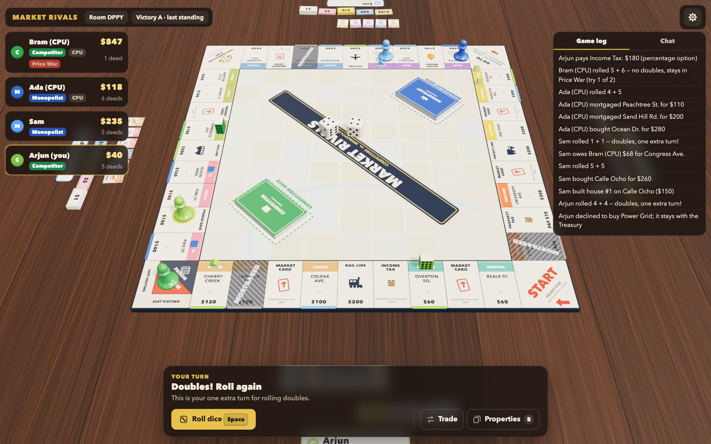
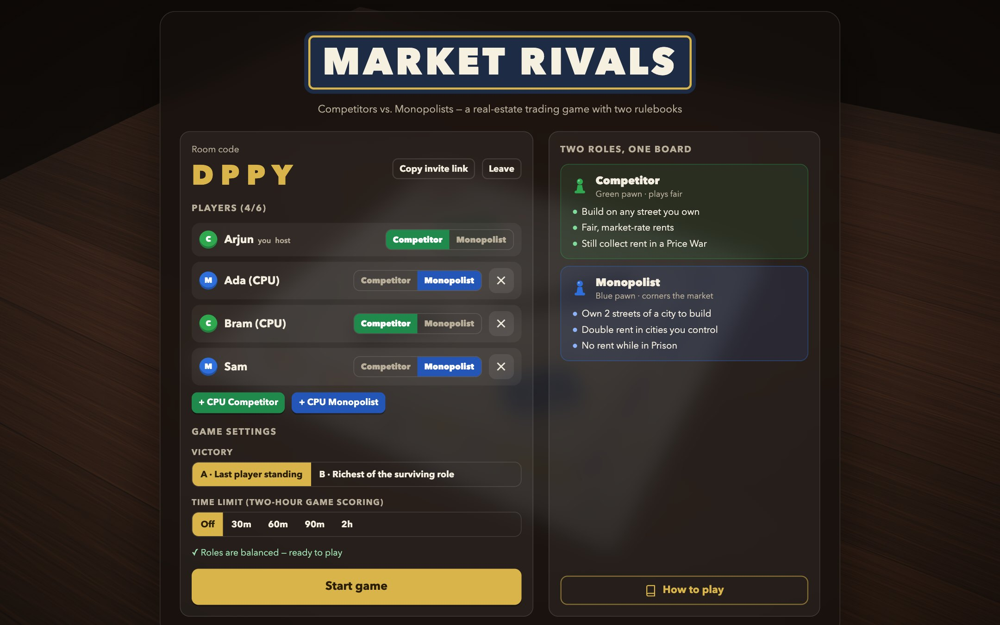
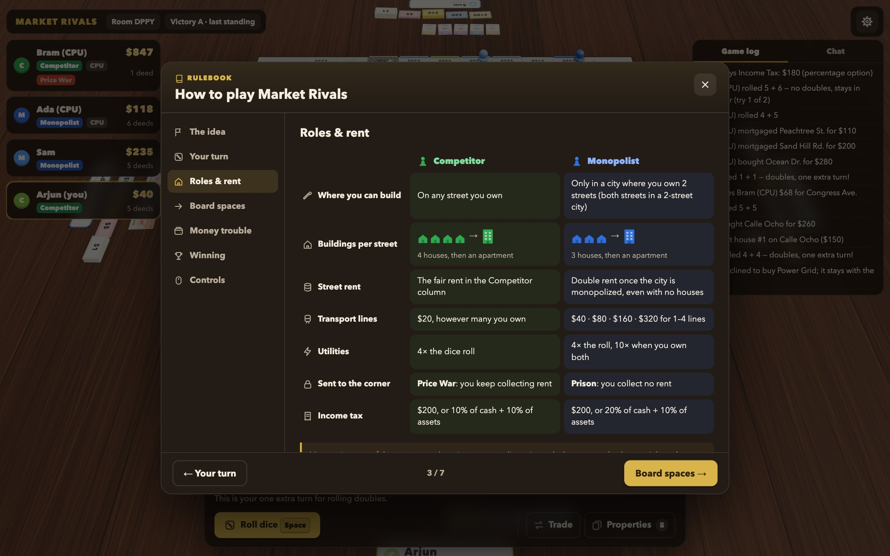
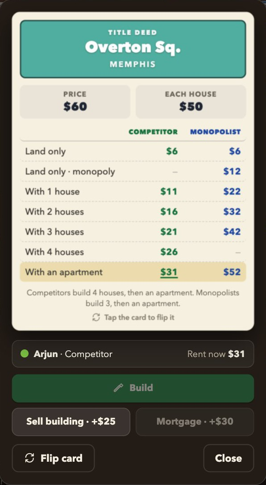
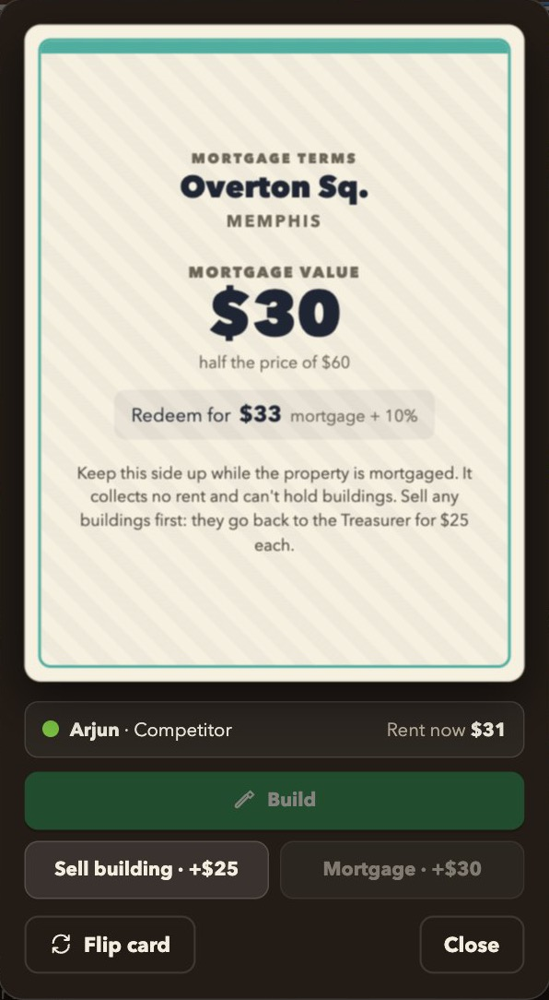
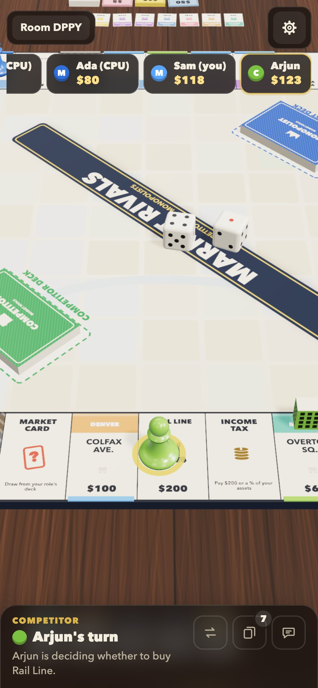
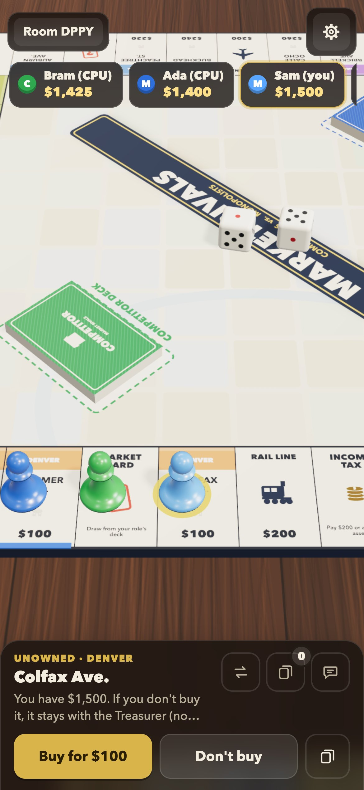
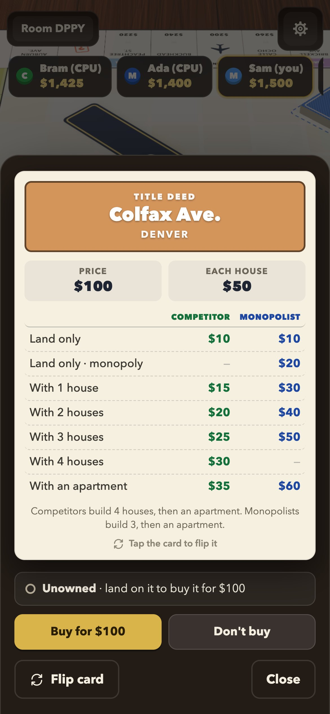
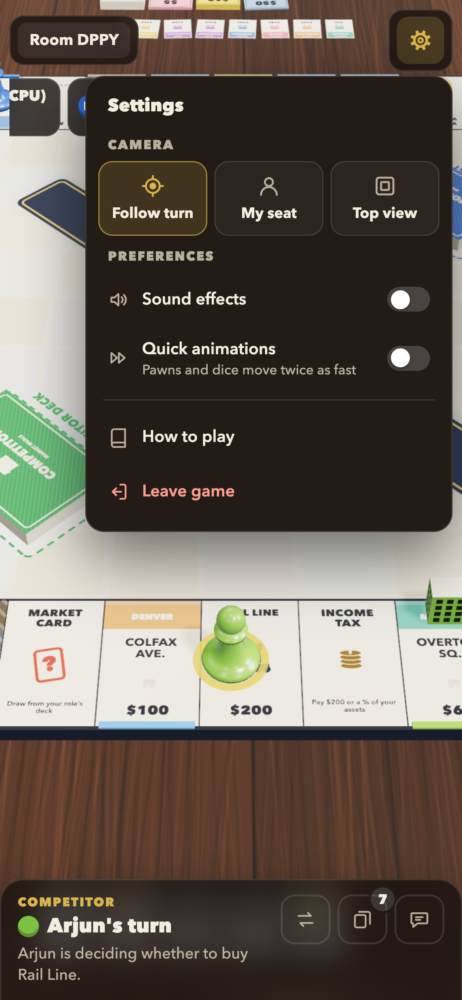
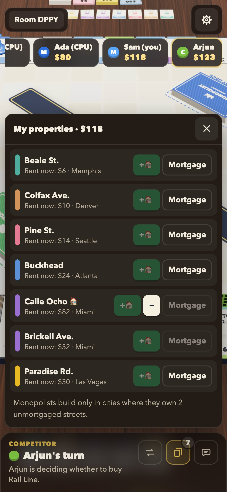

# Market Rivals

A real-time multiplayer board game for 2–6 players, played on a 3D tabletop in the browser.

Every player is a **Competitor** or a **Monopolist** for the whole game, and the two sides play by different rules. Competitors can build on any street they own and charge fair rents. Monopolists must corner a city before they can build, but then they charge double. Play with friends over your network or the internet, fill empty seats with CPU players, on a desktop or a phone.



## Screenshots

<table>
  <tr>
    <td width="50%"></td>
    <td width="50%"></td>
  </tr>
  <tr>
    <td align="center">Lobby: share the room code, add CPUs, pick roles</td>
    <td align="center">Built-in illustrated rulebook</td>
  </tr>
  <tr>
    <td align="center"></td>
    <td align="center"></td>
  </tr>
  <tr>
    <td align="center">Title deed: rents for both roles, current row highlighted</td>
    <td align="center">Flip it over for the mortgage terms</td>
  </tr>
</table>

### On a phone

The camera follows whoever's turn it is, gliding along with their pawn, and the controls sit within reach of your thumb.

<table>
  <tr>
    <td width="33%"></td>
    <td width="33%"></td>
    <td width="33%"></td>
  </tr>
  <tr>
    <td align="center">Following another player's turn</td>
    <td align="center">Buy or pass, one thumb away</td>
    <td align="center">Title deeds slide up as sheets</td>
  </tr>
  <tr>
    <td width="33%"></td>
    <td width="33%"></td>
    <td width="33%"></td>
  </tr>
  <tr>
    <td align="center">Settings: camera mode, sound, speed</td>
    <td align="center">Your properties: build, sell, mortgage</td>
    <td></td>
  </tr>
</table>

## Run it

Needs [Node.js](https://nodejs.org) (developed and tested with Node 26).

```bash
npm install
npm start
```

Open http://localhost:3000. The server also prints a `Network:` address: friends on the same Wi-Fi open that address and join with the 4-letter room code (or the **Copy invite link** button). To play over the internet, expose port 3000 with a tunnel, for example:

```bash
cloudflared tunnel --url http://localhost:3000
```

Set `PORT` to use a different port.

## How a game goes

1. **Create a table** and share the code. Up to 6 seats: fill them with **CPU Competitors** or **CPU Monopolists**.
2. Each player picks a role. Teams must be balanced: equal numbers, or one apart with an odd number of players.
3. The host picks the victory mode: **A**, last player standing, or **B**, the richest player of the surviving role. There's also an optional **time limit** with its own scoring.
4. Play: roll, move, buy or decline (there are no auctions), pay rent, draw from your role's card deck, build, mortgage, trade, end turn.

The **How to play** button in the lobby (and in the in-game settings menu) explains the full rules.

### The two roles at a glance

|                    | Competitor                         | Monopolist                                           |
| ------------------ | ---------------------------------- | ---------------------------------------------------- |
| Where you build    | On any street you own              | Only in a city where you own 2 streets               |
| Buildings          | 4 houses, then an apartment        | 3 houses, then an apartment                          |
| Rent               | Fair, market-rate rent             | Double rent once the city is monopolized             |
| Transport lines    | $20, however many you own          | $40 → $80 → $160 → $320                              |
| Utilities          | 4× the dice                        | 4×, or 10× with both                                 |
| Sent to the corner | Price War: you still collect rent  | Prison: you collect no rent                          |
| Income tax         | $200, or 10% of cash + 10% of assets | $200, or 20% of cash + 10% of assets               |

Everyone starts with $1,500 and collects $100 for passing START. Doubles give one extra turn. Nobody can borrow money.

## Controls

- **Mouse:** drag to orbit, scroll to zoom, right-drag to pan. Click any space or deed card to see its title deed, and click the deed to flip it to its mortgage side.
- **Touch:** one finger orbits, pinch zooms, two fingers pan, tap to inspect.
- **Keys:** `Space` roll · `E` end turn · `F` camera follows the turn · `S` camera at your seat · `T` top view · `Esc` close.
- The **gear menu** (top right) holds the camera mode, sound, quick animations, the game log, the rules and Leave game.

## Features

- **Authoritative server** (`server/game.js`) running every rule: role-specific rents and building limits, monopolies, transport and utility scaling, Prison and Price War, the Fair Competition Fund, both taxes, doubles, mortgages and redemption at +10%, debt and bankruptcy, validated player-to-player trades, and the A / B / timed endings.
- **CPU players** (`server/ai.js`): competitors buy to block monopolies, monopolists chase cities and transport lines. They build, mortgage, settle debts, judge trade offers, and monopolists make offers for the streets they're missing.
- **Rooms and reconnects:** 4-letter room codes, host controls and chat. Refreshing puts you back in your seat. A disconnected player's turns are played by a CPU after 20 seconds, and leaving mid-game hands your seat to a CPU.
- **3D table** (three.js, `client/scene/`):
  - The board, cards, dice and wood are all drawn in code.
  - Dice tumble and land on the server's roll, pawns hop space by space, and drawn cards fly up to face you.
  - Houses and apartments appear in the owner's colour.
  - Each seat has stacks of bills and deed cards that track that player.
  - All text on the board shrinks to fit its space, so it reads correctly with any device's fonts.
- **Phone-first HUD:**
  - A follow camera tracks the active pawn round the board.
  - Player chips scroll sideways, and the action bar is docked at the bottom.
  - The log, chat and property list open as sheets, and dialogs slide up from the bottom.
  - Sizes scale with the screen width.
  - Phones get a lighter board texture and shadow map.

## Tests

```bash
npm test     # 240 all-CPU games, checking rule invariants after every action
```

End-to-end over WebSockets (a scripted human vs. 3 CPUs, playing a full game):

```bash
MR_CPU_DELAY_SCALE=0 PORT=3999 npm start      # terminal 1: CPUs play instantly
node test/e2e-ws.js 3999                      # terminal 2
```

## Project layout

```
shared/data.js       board spaces, cities, cards (used by the server and the browser)
shared/rules.js      rent / building / mortgage / tax maths
server/              game engine, CPU logic, rooms, HTTP + WebSocket server
client/              index.html, style.css, main.js (state queue + animation), ui.js, rules.js, icons.js, net.js, sound.js
client/scene/        art.js (canvas artwork), world.js (renderer, camera, picking), director.js (follow camera), pieces.js (3D pieces)
test/                simulation and end-to-end tests
screenshots/         images used in this README
```

## Known limitations

- Game state lives in server memory, so restarting the server ends running games.
- CPU balance: in 2-player games CPU competitors and monopolists win about equally. With 4–6 players, CPU monopolists win most games, because competitor CPUs don't yet team up against them.
- Where the original rules are silent (for example, what an apartment costs), the game makes a reasonable call: an apartment costs one more house.

## Credits

The two-rulebook "Competitors vs. Monopolists" mechanics are based on Ralph Anspach's board game *Anti-Monopoly*. Market Rivals is an unofficial fan project, not affiliated with or endorsed by the owners of that game. Its name, board, cities and streets, card text and artwork are all original.
